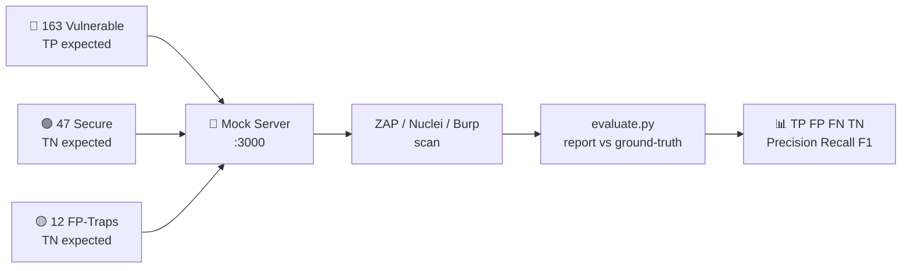

<div align="center">

# 🎯 DAST Benchmark Lab

### A Deliberately Vulnerable + Deliberately Secure Test Range for Measuring DAST Scanner Accuracy

**TP / FP / FN / TN scoring lab for OWASP ZAP • Burp Suite • Nuclei • Acunetix • Nessus**

[](https://nodejs.org/)
[](https://expressjs.com/)
[](https://www.python.org/)
[](https://owasp.org/Top10/)
[](./ground-truth.json)
[](./evaluation/verification.json)

[🚀 Quickstart](#-quickstart-2-minutes) •
[🛰️ Why DAST-Specific?](#️-why-purpose-built-for-dast) •
[🎚️ Difficulty Levels](#️-difficulty-levels) •
[📖 What Is This For?](./docs/NE-ISE-YARAR.md) •
[🔧 Setup Guide](./docs/KURULUM.md) •
[📊 Scanning & Scoring](./docs/TARAMA-VE-OLCUM.md) •
[❓ FAQ](./docs/SSS.md)

> 📝 Detailed guides under [`docs/`](./docs/) are currently in Turkish. The commands and code samples work regardless of language.

</div>

---

## 📌 What is this? (in 30 seconds)

> **Problem:** You run a DAST scanner. It reports 50 findings. How many are real? How many are false alarms? How many critical vulnerabilities did it **miss**? Normally, you can't know.
>
> **Solution:** This server gives you a target whose **answers are known in advance**:
> - 🔴 **163 vulnerable endpoints** → the scanner should find them (found = **TP**, missed = **FN**)
> - 🟢 **47 secure endpoints** → the scanner should stay silent (alert = **FP**, silent = **TN**)
> - 🟡 **12 FP-trap endpoints** → pages that look suspicious but are clean (WAF text, sample keys, slow report...). They measure the scanner's **false-positive discipline**.

`ground-truth.json` is the referee. Compare the scanner report with `evaluation/evaluate.py` → get **Precision / Recall / F1 + per-category breakdown**.



Concept deep-dive (Turkish) → **[📖 docs/NE-ISE-YARAR.md](./docs/NE-ISE-YARAR.md)**

---

## ✨ Highlights

| | |
|---|---|
| 🎯 **222 endpoints, one target** | SQLi (UNION / stacked / blind / second-order) • 4 SSTI engines • XSS (reflected / stored / DOM / blind / mXSS) • IDOR/BOLA • JWT attacks (alg:none, kid, jku, RS→HS) • SSRF bypass set • GraphQL • Prototype Pollution • Zip Slip • CSV formula • Business logic • Juice Shop-level SPA (`/app`) |
| ✅ **163/163 proof-verified** | `python evaluation/verify.py` fires a real payload at every vulnerability and confirms exploitability. Shown as a badge on the dashboard. |
| 🟡 **12 FP traps** | Where real tools false-positive the most: "SQL syntax" in help text, SAMPLE key in docs, nonce+CSP script, correct rate-limit, legitimately slow page... |
| 📊 **Persistent score tracking** | `scan.py start/finish` → every run stored as JSON under `evaluation/runs/`. Duration, request count, speed, coverage, CPU/RAM, 5xx, OOB, **ΔF1 vs previous run**. |
| 🔍 **FN analysis** | Every request lands in `logs/requests.log` with a signal tag (`sqli_probe`, `xss_probe`...). Distinguish "tried but missed" from "never tried". |
| 🛡️ **Safe to scan** | CMDi / SSRF / XXE / Deserialization / RFI / Zip Slip **never really execute** — pattern-match mocks. `ping` / `cat /etc/passwd` outputs are fake text. |
| 🧭 **Live dashboard** | `http://localhost:3000/dashboard` → 222-endpoint list with try-it links + score table + OOB triggers. |

---

## 🛰️ Why purpose-built for DAST?

> This project is not for SAST (code-reading) tools — it is built for scanners that **send HTTP requests to a live target and interpret responses**. Every design decision measures one DAST capability:

| DAST capability | What this project provides |
|---|---|
| 🕷️ **Crawling / discovery** | `/dashboard` links all 222 endpoints • `robots.txt` lists sensitive paths • JS-rendered SPA (`/app`) — separates classic spiders from AJAX spiders |
| 🎯 **Active fuzzing + oracle reading** | Deterministic flaw markers: error-based `SQL syntax`, boolean content diff, a **real 3-second** time-based delay (`/runtime/sqli-time`), header reflections (`Location`, `X-Injected`), `MOCK-SSRF-LEAK` markers |
| 🙈 **Blind/OOB detection** | `/oob/*` callback collector + `GET /api/oob-hits` counter — separates scanners that catch blind XSS / blind SSRF from those that don't |
| 🔐 **Authenticated scanning** | Bearer JWT (`/app/*`), cookies (`role`, `sessionid`), header-spoof scenarios (`X-User-Id`, `X-Role`, `X-Debug`) — an unauthenticated scan misses this whole surface (provable via FN analysis) |
| 🧠 **Judgement / FP resistance** | Every flaw has a **secure twin** (`/injection/sqli` → `/injection/sqli-secure`) + **12 FP traps** — text-matching rules fall into FP here |
| 📡 **Matching-friendly** | Every response carries `X-Vuln-Id`, `X-Vuln-Category`, `X-Ground-Truth` headers • `evaluate.py` matches trailing-slash and `:id`-placeholder insensitively |
| 📊 **Behavior profiling** | Signal-tagged request log answers "did it try and miss, or never try?" |
| 🛡️ **Safe fuzz target** | Dangerous vectors are mocks (no real command/request execution) — open the scanner to full throttle |

**In short:** SAST reads code, DAST talks to a target — this server is a conversation partner with 222 topics.

---

## 🎚️ Difficulty levels

> `severity` in `ground-truth.json` is **criticality, not difficulty**. The table below shows which **capability** a DAST scanner (or pentester) needs per level. Full list + scan profiles → **[🎚️ docs/ZORLUK-SEVIYELERI.md](./docs/ZORLUK-SEVIYELERI.md)**

| Level | Requires | Example endpoints | Scanner profile that catches it |
|---|---|---|---|
| 🟢 **Level 1 — Easy** `baseline catches it` | Passive scan + one simple payload | `/xss/reflected`, `/injection/sqli` (error-based), `/files/.env`, `/misconfig/headers`, `/robots.txt`, `/ssrf/redirect` | ZAP baseline, Nuclei default templates |
| 🟡 **Level 2 — Medium** `active scan + fuzz` | Active scan, wordlists, rule sets | Stored/DOM XSS, UNION/stacked SQLi, 4 SSTI engines, IDOR/traversal, JWT `alg:none`, lock-free OTP, GraphQL introspection, CORS `*`, SVG upload | ZAP full-scan, Burp Active Scan |
| 🟠 **Level 3 — Hard** `auth + logic + multi-step` | Logged-in scan, chaining, business-logic reasoning | Mass-assignment → admin escalation **chain** (`/app/api/profile` → `/app/api/feedback-view`), BOLA, coupon stacking/negative wallet, JWT `kid`/`jku`/RS→HS confusion, SSRF bypass set (decimal-IP, `@`, fragment), OAuth `redirect_uri`, second-order SQLi | Authenticated scan + API/GraphQL add-ons + manual support |
| 🔴 **Level 4 — Chaos / Master** `blind + timing + SPA + race` | Timing measurement, OOB listening, JS-render crawling, race windows | **Real 3-sec** time-based SQLi, blind XSS (`/runtime/feedback` → `/oob/*`), `/app` SPA AJAX crawl, single-coupon race (`/shop/coupon-race`), GraphQL depth DoS, cache poisoning | Tuned full-scan + AJAX spider + OOB handler |
| 🟣 **Level FP-Hunter** `judgement, not signal` | Discipline of NOT alerting | 12 FP traps (`/fp/search`, `/fp/sdk-example`, `/fp/slow-report`...) + 47 `secure` twins | Mature policy — naive rule sets fall into FP here |

```
Expected F1 curve:  high at Level 1  →  drops toward Level 4  →  FP-Hunter reveals FPR
Reading: "Recall 90% at Level 1 but 20% at Level 3 means the gap is coverage (auth/crawl), not detection."
```

---

## ⚡ Quickstart (2 minutes)

> Full step-by-step guide (Node/Python versions, Docker, port changes, troubleshooting — in Turkish) → **[🔧 docs/KURULUM.md](./docs/KURULUM.md)**

**Requirements:** Node.js 18+ • Python 3.10+ • (optional) Docker

```powershell
# 1) Install dependencies
npm install

# 2) Start the server
npm start
# [+] DAST mock server: http://localhost:3000/dashboard
```

```powershell
# 3) New terminal — is everything working? (expect 163/163)
python evaluation/verify.py
# === VERIFIED: 163/163 exploitable ===
```

🎉 Open **`http://localhost:3000/dashboard`** — you'll see all endpoints with "try it" links.

Quick test payloads:

```
XSS:     /xss/reflected?name=<script>alert(1)</script>
SQLi:    /injection/sqli?id=1' OR '1'='1
IDOR:    /access/idor?user_id=99
BOLA:    /api/users/99  (returns TCKN+IBAN)
GraphQL: POST /graphql {"query":"{ __schema { queryType { name } } }"}
SSRF:    /ssrf?url=http://169.254.169.254/latest/meta-data/
JWT:     /auth/jwt-none?token=<alg:none token>
OTP:     POST /authx/otp {"code":"0000"}  (no lockout, spray away)
```

---

## 📊 Score your scanner (recommended flow)

```powershell
# 0) Self-verification (once)
python evaluation/verify.py

# 1) Start the run (marks the time window)
python evaluation/scan.py start --scanner "ZAP 2.14"

# 2) Run the scanner (example: ZAP baseline + resource monitor IN PARALLEL)
pip install psutil
python evaluation/agent.py --process java   # separate terminal, for ZAP
docker run --rm --network host ghcr.io/zaproxy/zaproxy:stable zap-baseline.py -t http://localhost:3000 -J zap-report.json

# 3) Finish + measure + save
python evaluation/scan.py finish --findings zap-report.json --format zap --exit-code 0 --errors 0 --note "first ZAP run"

# 4) See history
python evaluation/scan.py list
# or dashboard: http://localhost:3000/dashboard  |  GET /api/scans
```

One-shot quick look (no record saved):

```powershell
python evaluation/evaluate.py --findings zap-report.json --format zap
python evaluation/evaluate.py --findings nuclei.jsonl --format nuclei
```

Supported report formats: `generic` • `zap` • `zap-xml` • `sarif` • `nuclei`

Full guide (ZAP full-scan, Nuclei, Burp, FN analysis, OOB, APIs — in Turkish) → **[📊 docs/TARAMA-VE-OLCUM.md](./docs/TARAMA-VE-OLCUM.md)**

### Sample score output

```
=== OVERALL (222 endpoints, 41 findings) ===
TP=35  FP=2  FN=128  TN=57
Precision=0.946  Recall=0.215  F1=0.350  FPR=0.034

=== BY CATEGORY ===
Category                TP  FP  FN  TN  Prec   Rec    F1
A03-Injection           12   0  15   4   1.00  0.44  0.61
A07-Auth                 5   1  18   7   0.83  0.22  0.34
...
```

---

## 🧮 Scoring logic

| Endpoint type | Expectation | Scanner alerts | Scanner stays silent |
|---|---|---|---|
| 🔴 `vulnerable` (real flaw) | Should alert | **TP** ✅ | **FN** ❌ (missed) |
| 🟢 `secure` (secure control) | Should stay silent | **FP** ❌ (false alarm) | **TN** ✅ |
| 🟡 `fp-trap` (FP trap) | Should stay silent | **FP** ❌ | **TN** ✅ |

Every response carries these headers (don't affect the DAST, help with matching):

```
X-Vuln-Id: INJ-SQLI-01
X-Vuln-Category: A03-Injection
X-Ground-Truth: vulnerable | secure | fp-trap
```

Concepts + example scenarios (Turkish) → **[📖 docs/NE-ISE-YARAR.md](./docs/NE-ISE-YARAR.md)**

---

## 🗂️ Category map

<details>
<summary><b>Distribution of the 222 endpoints — click to expand</b></summary>

| Category | Vulnerable | Secure | FP-Trap | Examples |
|---|---|---|---|---|
| A03-Injection | 23 | 4 | – | UNION / stacked / time-based / boolean / second-order SQLi, NoSQLi, CMDi (mock), 4 SSTI engines, LDAPi, XPath, XXE, CRLF, log4shell (mock) |
| A07-Auth | 23 | 7 | – | JWT alg:none / kid / jku / weak-secret / RS→HS confusion / jwk, lock-free OTP, MFA bypass, OAuth redirect_uri, enumeration, magic-hash, session fixation |
| APP-Shop (Juice Shop-level) | 23 | 4 | – | JWT login, mass-assignment escalation chain, address/order IDOR, coupon stacking, negative wallet, unlimited refund, CAPTCHA-bypass stored XSS, sequential recovery codes |
| A01-AccessControl | 12 | 5 | – | IDOR, traversal, forced browsing, open redirect (+bypasses), CSRF, HPP, verb confusion, X-Original-URL / XFF bypass |
| A05-Exposure | 11 | – | – | .env, .bak, .DS_Store, source-map, swagger, actuator, robots.txt, phpinfo, package/composer.json |
| API-Security | 9 | 5 | – | BOLA (TCKN/IBAN), mass-assignment, excessive data, OTP rate-limit, API key in URL, pagination abuse, sequential invite, BFLA |
| Client-Side | 9 | 4 | – | postMessage XSS, JSONP, markdown XSS, DOM clobbering, prototype pollution, `javascript:` redirect, attribute/JS-string context XSS |
| A04-FileHandling | 9 | 3 | – | SVG XSS, Zip Slip (mock), LFI/RFI (mock), CSV formula, double-extension upload, wrapper/unicode traversal |
| A03-XSS | 8 | 3 | – | Reflected / stored / DOM / blind + mXSS + log-poisoning viewer |
| A05-Misconfig | 8 | 3 | – | Missing headers, verbose errors, dir-listing, default creds, CORS `*`, clickjacking, TRACE, crossdomain.xml |
| A10-SSRF | 6 | 2 | – | Mock SSRF + decimal-IP / 0.0.0.0 / `@` / fragment / redirect-chain bypasses |
| A05-CacheSmuggle | 6 | 2 | – | Host poisoning, cache deception (PII), method-override, CL.TE oracle, cache-poisoning search |
| A02-Crypto | 5 | 1 | – | PAN exposure, debug env leak, .git exposure, MD5, reset-token Referer leak |
| A04-BusinessLogic | 4 | 2 | – | Client-side pricing, negative quantity, coupon race, sequential order IDs |
| API-GraphQL | 4 | 1 | – | Introspection, batch brute-force, depth DoS, GraphQL IDOR |
| A04-InsecureDesign | 2 | 1 | – | Unrestricted upload, coupon reuse |
| A08-Integrity | 1 | – | – | Deserialization (mock) |
| FP-Trap | – | – | 12 | Help text, SAMPLE key, WAF page, nonce+CSP, correct lockout, single-use coupon, legit slow report... |
| **TOTAL** | **163** | **47** | **12** | **222** |

</details>

> ⚠️ **Safety note:** CMDi / SSRF / XXE / Deserialization / RFI / Zip Slip **never really execute** — pattern-match simulations. `ping`, `cat /etc/passwd`, metadata outputs are mock text. Safe to scan.

---

## 🖥️ Dashboard & APIs

| Address | What you get |
|---|---|
| `GET /dashboard` | Human panel: endpoint list + score table |
| `GET /app` | Juice Shop-level SPA (JS-rendered, scanner scoreboard at `/app/coverage`) |
| `GET /api/overview` | Badge data: GT counts + verified vulns + recorded scans |
| `GET /api/scans` | Last 30 runs (duration, speed, coverage, TP/FP/FN/TN, CPU/RAM, ΔF1) |
| `GET /api/stats` | Log summary: request count + signal distribution |
| `GET /api/oob-hits` | Blind-callback triggers |
| `GET /api/ground-truth` | Live `ground-truth.json` |

---

## 📁 Project structure

```
server.js                  → Express entry, router mounting, dashboard, APIs
ground-truth.json          → the referee (222 endpoints: 163 vuln + 47 secure + 12 fp-trap)
lib/
  utils.js                 → escHtml, fake DB, payload heuristics
  requestLogger.js         → logs every request to logs/requests.log with signal tags
routes/                    → categories (injection, xss, access, auth, authx, api,
                             graphql, client, files, shop, cache, crypto, misconfig,
                             ssrf, logic, runtime, chaos, edge, shopapp, oob, fptraps)
evaluation/
  verify.py                → self-verification: proof payload per vuln (163/163) + verification.json
  evaluate.py              → TP/FP/FN/TN + precision/recall/F1 calculator (importable)
  scan.py                  → start/finish/list: persistent records with time+errors+coverage
  agent.py                 → scanner-machine CPU/RAM monitor (psutil)
  runs/                    → scan records (JSON, append-only — ZAP vs Nuclei comparison)
  ornek-bulgular.json      → sample generic-finding format
logs/
  requests.log             → every request (JSON-lines + signal tags)
  oob.log                  → blind-callback triggers
  scans.jsonl              → scan-start markers
docs/  (Turkish guides)
  KURULUM.md               → detailed setup guide
  NE-ISE-YARAR.md          → concept + TP/FP/FN/TN + who is it for?
  ZORLUK-SEVIYELERI.md     → DAST-specific design + 5 difficulty levels + scan profiles
  TARAMA-VE-OLCUM.md       → ZAP/Nuclei/Burp + scan.py + FN analysis + OOB
  SSS.md                   → FAQ + troubleshooting
```

---

## 📚 Documentation (Turkish)

| Document | Content |
|---|---|
| [🔧 docs/KURULUM.md](./docs/KURULUM.md) | Node/Python/Docker setup, first run, port changes, `verify.py`, common errors |
| [📖 docs/NE-ISE-YARAR.md](./docs/NE-ISE-YARAR.md) | Which problem it solves, TP/FP/FN/TN, ground-truth & FP-trap concepts, audience |
| [🎚️ docs/ZORLUK-SEVIYELERI.md](./docs/ZORLUK-SEVIYELERI.md) | DAST-specific design, 5 difficulty levels, severity-vs-difficulty, scanner profiles |
| [📊 docs/TARAMA-VE-OLCUM.md](./docs/TARAMA-VE-OLCUM.md) | Scanning with ZAP / Nuclei / Burp, `scan.py` flow, `agent.py`, FN analysis, OOB, APIs |
| [❓ docs/SSS.md](./docs/SSS.md) | 15+ Q&A + troubleshooting table |

---

## 🤝 Contributing

1. Fork → feature branch → make your change
2. Run `python evaluation/verify.py` to confirm 163/163 still green
3. New endpoint? Add its `ground-truth.json` row + `verify.py` proof together
4. Open a PR (Turkish or English, both fine)

---

## 📄 License

See [LICENSE](./LICENSE). Educational and testing purposes only. Contains deliberately vulnerable code — **never run in production or exposed to the internet.** Use at your own risk.

<div align="center">

**⭐ If it helped, leave a star — happy scanning! 🎯**

</div>
