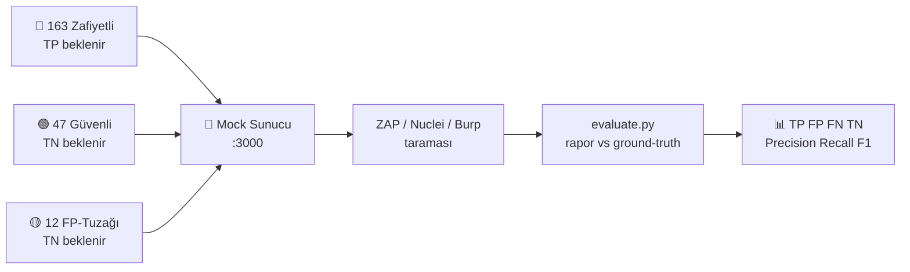

<div align="center">

# 🎯 DAST Mock Sunucu

### DAST Tarayıcılarının Doğruluğunu Ölçen Bilerek Zafiyetli + Bilerek Güvenli Test Alanı

**OWASP ZAP • Burp Suite • Nuclei • Acunetix • Nessus için TP / FP / FN / TN skorlama laboratuvarı**

[](https://nodejs.org/)
[](https://expressjs.com/)
[](https://www.python.org/)
[](https://owasp.org/Top10/)
[](./ground-truth.json)
[](./evaluation/verification.json)

[🚀 Hızlı Kurulum](#-hızlı-kurulum-2-dakika) •
[🛰️ Neden DAST'a Özel?](#️-neden-dasta-özel-tasarlandı) •
[🎚️ Zorluk Seviyeleri](#️-zorluk-seviyeleri) •
[📖 Ne İşe Yarar?](./docs/NE-ISE-YARAR.md) •
[🔧 Detaylı Kurulum](./docs/KURULUM.md) •
[📊 Tarama ve Ölçüm](./docs/TARAMA-VE-OLCUM.md) •
[❓ SSS](./docs/SSS.md)

</div>

---

## 📌 Bu proje ne işe yarar? (30 saniyede)

> **Sorun:** Bir DAST tarayıcısı çalıştırdın. 50 bulgu verdi. Kaçı gerçek? Kaçı yanlış alarm? Kaç kritik açığı **kaçırdı?** Bunu normalde bilemezsin.
>
> **Çözüm:** Bu sunucu sana **cevabı önceden bilinen** bir hedef verir:
> - 🔴 **163 zafiyetli endpoint** → tarayıcı bulmalı (bulursa **TP**, bulamazsa **FN**)
> - 🟢 **47 güvenli endpoint** → tarayıcı susmalı (öterse **FP**, susarsa **TN**)
> - 🟡 **12 FP-tuzağı endpoint** → bilerek "şüpheli görünüp" temiz olan sayfalar (WAF metni, örnek anahtar, yavaş rapor...). Tarayıcının **yanlış alarm avcılığını** ölçer.

`ground-truth.json` = hakem heyeti. Tarayıcı raporunu `evaluation/evaluate.py` ile karşılaştırıyorsun → **Precision / Recall / F1 + kategori kırılımı** alıyorsun.



Detaylı konsept anlatımı → **[📖 docs/NE-ISE-YARAR.md](./docs/NE-ISE-YARAR.md)**

---

## ✨ Öne çıkanlar

| | |
|---|---|
| 🎯 **222 endpoint, tek hedef** | SQLi (UNION / stacked / blind / second-order) • 4 SSTI motoru • XSS (reflected / stored / DOM / blind / mXSS) • IDOR/BOLA • JWT saldırıları (alg:none, kid, jku, RS→HS) • SSRF bypass seti • GraphQL • Prototype Pollution • Zip Slip • CSV formül • Business logic • Juice Shop seviyesi SPA (`/app`) |
| ✅ **163/163 proof ile doğrulanmış** | `python evaluation/verify.py` her zafiyete gerçek payload gönderir, sömürülebilirliği teyit eder. Rozet dashboard'da görünür. |
| 🟡 **12 FP-tuzağı** | Gerçek araçların en çok false-positive verdiği yerler: yardım metnindeki "SQL syntax", dokümandaki ÖRNEK anahtar, nonce+CSP'li script, doğru rate-limit, meşru yavaş sayfa... |
| 📊 **Kalıcı skor takibi** | `scan.py start/finish` → her koşu `evaluation/runs/` altında JSON saklanır. Süre, istek sayısı, hız, coverage, CPU/RAM, 5xx, OOB, **önceki koşuyla ΔF1** karşılaştırması. |
| 🔍 **FN analizi** | Her istek `logs/requests.log`'a sinyal etiketiyle düşer (`sqli_probe`, `xss_probe`...). Tarayıcı denedi de mi bulamadı, hiç denemedi mi? Ayırt edersin. |
| 🛡️ **Güvenle taratılabilir** | CMDi / SSRF / XXE / Deserialization / RFI / Zip Slip **gerçekten çalışmaz** — pattern-match mock'tur. `ping` / `cat /etc/passwd` çıktıları sahte metindir. |
| 🧭 **Canlı dashboard** | `http://localhost:3000/dashboard` → 222 endpoint listesi + deneme linkleri + skor tablosu + OOB tetikler. |

---

## 🛰️ Neden DAST'a özel tasarlandı?

> Bu proje SAST (kod okuyan) araçlar için değil, **çalışan hedefe HTTP isteği atıp yanıtı yorumlayan** DAST tarayıcıları için inşa edildi. Her tasarım kararı bir DAST yeteneğini ölçer:

| DAST yeteneği | Projedeki karşılığı |
|---|---|
| 🕷️ **Crawl / keşif** | `/dashboard` tüm 222 endpoint'i linkler • `robots.txt` + sitemap hissi veren liste • JS-render SPA (`/app`) — klasik spider mı, AJAX spider mı? ayrımı burada belli olur |
| 🎯 **Aktif fuzz + oracle okuma** | Deterministik zaaf işaretleri: error-based `SQL syntax`, boolean içerik farkı, **gerçek 3 sn uyuyan** time-based (`/runtime/sqli-time`), header yankıları (`Location`, `X-Injected`), `MOCK-SSRF-LEAK` marker'ları |
| 🙈 **Kör (blind/OOB) bulma** | `/oob/*` callback toplayıcı + `GET /api/oob-hits` sayacı — blind XSS / blind SSRF / log4shell'i bulanla bulamayan ayrılır |
| 🔐 **Authenticated tarama** | Bearer JWT (`/app/*`), cookie (`role`, `sessionid`), header-spoof (`X-User-Id`, `X-Role`, `X-Debug`) senaryoları — girişsiz tarama bu yüzeyin tamamını kaçırır (FN analiziyle kanıtlanır) |
| 🧠 **Muhakeme / FP direnci** | Her zaafın **güvenli ikizi** (`/injection/sqli` → `/injection/sqli-secure`) + **12 FP-tuzağı** — metin-eşleşmeyle öten kurallar burada FP'ye düşer |
| 📡 **Eşleştirme dostu** | Her yanıtta `X-Vuln-Id`, `X-Vuln-Category`, `X-Ground-Truth` header'ı • `evaluate.py` trailing-slash ve `:id` placeholder duyarsız eşleşir |
| 📊 **Davranış profili** | `logs/requests.log` her isteği sinyal etiketiyle yazar (`sqli_probe`, `xss_probe`...) → "denedi de bulamadı mı, hiç denemedi mi?" sorusu cevaplanır |
| 🛡️ **Güvenli fuzz hedefi** | CMDi / SSRF / XXE / Deserialization / RFI / Zip Slip **gerçekten çalışmaz** (pattern-match mock) — tarayıcıyı sonuna kadar açabilirsin |

**Kısacası:** SAST "kodu okur", DAST "hedefle konuşur" — bu sunucu konuşmaya hazır 222 konulu bir muhataptır.

---

## 🎚️ Zorluk seviyeleri

> `ground-truth.json`'daki `severity` (kritiklik) **zorluk değildir**. Aşağıdaki tablo, bir DAST tarayıcısının (veya pentester'ın) her seviyede **hangi yeteneğe** ihtiyaç duyduğunu gösterir. Detaylı liste + önerilen tarama profili → **[🎚️ docs/ZORLUK-SEVIYELERI.md](./docs/ZORLUK-SEVIYELERI.md)**

| Seviye | Ne ister? | Örnek endpoint'ler | Yakalayan tarayıcı profili |
|---|---|---|---|
| 🟢 **Seviye 1 — Kolay** `baseline yakalar` | Pasif tarama + basit payload yeter | `/xss/reflected`, `/injection/sqli` (error-based), `/files/.env`, `/misconfig/headers`, `/robots.txt`, `/ssrf/redirect` | ZAP baseline, Nuclei default şablonlar |
| 🟡 **Seviye 2 — Orta** `aktif tarama + fuzz` | Aktif scan, kelime listesi, kural seti gerekir | Stored/DOM XSS, UNION/stacked SQLi, 4 SSTI motoru, IDOR/traversal, JWT `alg:none`, kilitsiz OTP, GraphQL introspection, CORS `*`, SVG upload | ZAP full-scan, Burp Active Scan |
| 🟠 **Seviye 3 — Zor** `auth + mantık + çok adım` | Girişli tarama, zincir kurma, iş-mantığı anlama gerekir | Mass-assignment → admin escalation **zinciri** (`/app/api/profile` → `/app/api/feedback-view`), BOLA, kupon istifleme/negatif cüzdan, JWT `kid`/`jku`/RS→HS confusion, SSRF bypass seti (desimal-IP, `@`, fragment), OAuth `redirect_uri`, second-order SQLi | Authenticated scan + API/GraphQL eklentileri + manuel destek |
| 🔴 **Seviye 4 — Kaos / Usta** `kör + zaman + SPA + yarış` | Zaman ölçümü, OOB dinleme, JS-render crawl, race-condition gerekir | **Gerçek 3 sn** time-based SQLi, blind XSS (`/runtime/feedback` → `/oob/*`), `/app` SPA AJAX crawl, tek kupon race (`/shop/coupon-race`), GraphQL depth DoS, cache-poisoning | İnce ayarlı full-scan + AJAX spider + OOB handler (Interactsh/Boomerang benzeri) |
| 🟣 **Seviye FP-Avcısı** `sinyal değil muhakeme` | Alarm üretMEme disiplini ölçülür | 12 FP-tuzağı (`/fp/search`, `/fp/sdk-example`, `/fp/slow-report`...) + 47 `secure` ikiz | Olgun policy — acemi kural seti burada FP'ye düşer |

```
Beklenen F1 eğrisi:  Seviye 1'de yüksek  →  Seviye 4'e doğru düşer  →  FP-Avcısı'nda FPR belli olur
Yorum: "Recall Seviye 1'de %90, Seviye 3'te %20 ise sorun dedektörde değil kapsamdadır (auth/crawl eksik)."
```

---

## ⚡ Hızlı kurulum (2 dakika)

> Tam adım adım rehber (Node/Python sürümleri, Docker, port değiştirme, hata çözümleri) → **[🔧 docs/KURULUM.md](./docs/KURULUM.md)**

**Gerekenler:** Node.js 18+ • Python 3.10+ • (opsiyonel) Docker

```powershell
# 1) Bağımlılıkları kur
npm install

# 2) Sunucuyu başlat
npm start
# [+] DAST mock server: http://localhost:3000/dashboard
```

```powershell
# 3) Yeni terminal — her şey çalışıyor mu? (163/163 beklenir)
python evaluation/verify.py
# === DOĞRULAMA: 163/163 sömürülebilir ===
```

🎉 Tarayıcıyı aç: **`http://localhost:3000/dashboard`** — tüm endpoint'leri "dene" linkleriyle göreceksin.

Hızlı test payloadları:

```
XSS:    /xss/reflected?name=<script>alert(1)</script>
SQLi:   /injection/sqli?id=1' OR '1'='1
IDOR:   /access/idor?user_id=99
BOLA:   /api/users/99  (TCKN+IBAN döner)
GraphQL: POST /graphql {"query":"{ __schema { queryType { name } } }"}
SSRF:   /ssrf?url=http://169.254.169.254/latest/meta-data/
JWT:    /auth/jwt-none?token=<alg:none token>
OTP:    POST /authx/otp {"code":"0000"}  (kilit yok, dene dur)
```

---

## 📊 Tarayıcını ölç (tavsiye edilen akış)

```powershell
# 0) Öz-doğrulama (bir kez)
python evaluation/verify.py

# 1) Taramayı başlat (işaret koyulur)
python evaluation/scan.py start --scanner "ZAP 2.14"

# 2) Tarayıcıyı çalıştır (örnek: ZAP baseline + AYNI ANDA kaynak ölçer)
pip install psutil
python evaluation/agent.py --process java   # ayrı terminalde, ZAP için
docker run --rm --network host ghcr.io/zaproxy/zaproxy:stable zap-baseline.py -t http://localhost:3000 -J zap-rapor.json

# 3) Bitir + ölç + kaydet
python evaluation/scan.py finish --findings zap-rapor.json --format zap --exit-code 0 --errors 0 --note "ilk ZAP koşusu"

# 4) Geçmişi gör
python evaluation/scan.py list
# veya dashboard: http://localhost:3000/dashboard  |  GET /api/scans
```

Tek seferlik hızlı bakış (kayıt tutmadan):

```powershell
python evaluation/evaluate.py --findings zap-rapor.json --format zap
python evaluation/evaluate.py --findings nuclei.jsonl --format nuclei
```

Desteklenen rapor formatları: `generic` • `zap` • `zap-xml` • `sarif` • `nuclei`

Tam rehber (ZAP full-scan, Nuclei, Burp, FN analizi, OOB, API'ler) → **[📊 docs/TARAMA-VE-OLCUM.md](./docs/TARAMA-VE-OLCUM.md)**

### Örnek skor çıktısı

```
=== GENEL SONUÇ (222 endpoint, 41 bulgu) ===
TP=35  FP=2  FN=128  TN=57
Precision=0.946  Recall=0.215  F1=0.350  FPR=0.034

=== KATEGORİ BAZLI ===
Kategori                TP  FP  FN  TN  Prec   Rec    F1
A03-Injection           12   0  15   4   1.00  0.44  0.61
A07-Auth                 5   1  18   7   0.83  0.22  0.34
...
```

---

## 🧮 Skorlama mantığı

| Endpoint tipi | Beklenti | Tarayıcı bulursa | Bulamazsa |
|---|---|---|---|
| 🔴 `vulnerable` (gerçek zaaf) | Alarm üretmeli | **TP** ✅ | **FN** ❌ (kaçırdı) |
| 🟢 `secure` (güvenli kontrol) | Sessiz kalmalı | **FP** ❌ (yanlış alarm) | **TN** ✅ |
| 🟡 `fp-trap` (FP tuzağı) | Sessiz kalmalı | **FP** ❌ | **TN** ✅ |

Her yanıt şu header'ları taşır (DAST'yi etkilemez, eşleştirmede yardımcı olur):

```
X-Vuln-Id: INJ-SQLI-01
X-Vuln-Category: A03-Injection
X-Ground-Truth: vulnerable | secure | fp-trap
```

Kavramların detaylı anlatımı + örnek senaryolar → **[📖 docs/NE-ISE-YARAR.md](./docs/NE-ISE-YARAR.md)**

---

## 🗂️ Kategori haritası

<details>
<summary><b>222 endpoint'in dağılımı — tıklayarak aç</b></summary>

| Kategori | Zafiyetli | Güvenli | FP-Tuzağı | Örnekler |
|---|---|---|---|---|
| A03-Injection | 23 | 4 | – | UNION / stacked / time-based / boolean / second-order SQLi, NoSQLi, CMDi (mock), 4 SSTI motoru, LDAPi, XPath, XXE, CRLF, log4shell (mock) |
| A07-Auth | 23 | 7 | – | JWT alg:none / kid / jku / weak-secret / RS→HS confusion / jwk, OTP kilitsiz, MFA bypass, OAuth redirect_uri, enumeration, magic-hash, session fixation |
| APP-Shop (Juice Shop seviyesi) | 23 | 4 | – | JWT login, mass-assignment escalation zinciri, adres/sipariş IDOR, kupon istifleme, negatif cüzdan, sınırsız iade, CAPTCHA bypass stored XSS, sıralı kurtarma kodu |
| A01-AccessControl | 12 | 5 | – | IDOR, traversal, forced browsing, open redirect (+bypass'lar), CSRF, HPP, verb confusion, X-Original-URL / XFF bypass |
| A05-Exposure | 11 | – | – | .env, .bak, .DS_Store, source-map, swagger, actuator, robots.txt, phpinfo, package/composer.json |
| API-Security | 9 | 5 | – | BOLA (TCKN/IBAN), mass-assignment, excessive data, OTP rate-limit, URL'de API key, pagination abuse, sıralı davet, BFLA |
| Client-Side | 9 | 4 | – | postMessage XSS, JSONP, markdown XSS, DOM clobbering, prototype pollution, `javascript:` redirect, attribute/JS-string context XSS |
| A04-FileHandling | 9 | 3 | – | SVG XSS, Zip Slip (mock), LFI/RFI (mock), CSV formül, çift uzantı upload, wrapper/unicode traversal |
| A03-XSS | 8 | 3 | – | Reflected / stored / DOM / blind + mXSS + log-poisoning viewer |
| A05-Misconfig | 8 | 3 | – | Eksik header, verbose error, dir-listing, default creds, CORS `*`, clickjacking, TRACE, crossdomain.xml |
| A10-SSRF | 6 | 2 | – | Mock SSRF + desimal-IP / 0.0.0.0 / `@` / fragment / redirect-chain bypass'ları |
| A05-CacheSmuggle | 6 | 2 | – | Host zehirlenmesi, cache deception (PII), method-override, CL.TE oracle, cache-poisoning search |
| A02-Crypto | 5 | 1 | – | PAN ifşası, debug env leak, .git ifşası, MD5, reset-token Referer sızıntısı |
| A04-BusinessLogic | 4 | 2 | – | Client-side fiyat, negatif adet, kupon race, sıralı sipariş ID |
| API-GraphQL | 4 | 1 | – | Introspection, batch brute-force, depth DoS, GraphQL IDOR |
| A04-InsecureDesign | 2 | 1 | – | Sınırsız upload, kupon reuse |
| A08-Integrity | 1 | – | – | Deserialization (mock) |
| FP-Trap | – | – | 12 | Yardım metni, ÖRNEK anahtar, WAF satırı, nonce+CSP, doğru kilit, tek-kullanımlık kupon, meşru yavaş rapor... |
| **TOPLAM** | **163** | **47** | **12** | **222** |

</details>

> ⚠️ **Güvenlik notu:** CMDi / SSRF / XXE / Deserialization / RFI / Zip Slip **gerçekten çalıştırılmaz**, pattern-match simülasyondur. `ping`, `cat /etc/passwd`, metadata çıktıları mock metindir. Güvenle taratılabilir.

---

## 🖥️ Dashboard ve API'ler

| Adres | Ne verir? |
|---|---|
| `GET /dashboard` | 222 endpoint listesi + deneme linkleri + skor tablosu + hızlı payload'lar |
| `GET /app` | Juice Shop seviyesi SPA (JS-render, scanner score-board `/app/coverage` dahil) |
| `GET /api/overview` | Rozet verisi: GT sayısı + doğrulanmış zafiyet + kayıtlı tarama |
| `GET /api/scans` | Son 30 koşunun özeti (süre, istek, hız, coverage, TP/FP/FN/TN, CPU/RAM, ΔF1) |
| `GET /api/stats` | `requests.log` özeti: toplam istek + sinyal sayımları + son 20 istek |
| `GET /api/oob-hits` | Kör callback tetikleri (blind XSS / SSRF ölçümü) |
| `GET /api/ground-truth` | `ground-truth.json`'un canlı hali |

---

## 📁 Proje yapısı

```
server.js                  → Express giriş, router montajı, dashboard, API'ler
ground-truth.json          → hakem heyeti (222 endpoint: 163 vuln + 47 secure + 12 fp-trap)
lib/
  utils.js                 → escHtml, fake DB, payload sezgileri
  requestLogger.js         → her isteği logs/requests.log'a sinyal etiketiyle yazar
routes/                    → kategoriler (injection, xss, access, auth, authx, api,
                             graphql, client, files, shop, cache, crypto, misconfig,
                             ssrf, logic, runtime, chaos, edge, shopapp, oob, fptraps)
evaluation/
  verify.py                → öz-doğrulama: her zafiyete proof payload (163/163) + verification.json
  evaluate.py              → TP/FP/FN/TN + precision/recall/F1 hesaplayıcı (import edilebilir)
  scan.py                  → start/finish/list: süre+hata+coverage'lı kalıcı kayıt
  agent.py                 → tarayıcı-makine CPU/RAM ölçer (psutil)
  runs/                    → tarama kayıtları (JSON, silinmez — ZAP vs Nuclei karşılaştırması)
  ornek-bulgular.json      → örnek generic bulgu formatı
logs/
  requests.log             → her istek (JSON-lines + sinyal etiketleri)
  oob.log                  → kör callback tetikleri
  scans.jsonl              → tarama başlangıç işaretleri
docs/
  KURULUM.md               → detaylı kurulum rehberi
  NE-ISE-YARAR.md          → konsept + TP/FP/FN/TN + kimler için?
  ZORLUK-SEVIYELERI.md     → DAST'a özel tasarım + 5 zorluk seviyesi + tarama profilleri
  TARAMA-VE-OLCUM.md       → ZAP/Nuclei/Burp + scan.py + FN analizi + OOB
  SSS.md                   → sık sorulan sorular + sorun giderme
```

---

## 📚 Dokümantasyon

| Doküman | İçerik |
|---|---|
| [🔧 docs/KURULUM.md](./docs/KURULUM.md) | Node/Python/Docker kurulumu, ilk çalıştırma, port değiştirme, `verify.py`, sık hatalar ve çözümleri |
| [📖 docs/NE-ISE-YARAR.md](./docs/NE-ISE-YARAR.md) | Bu proje hangi sorunu çözer? TP/FP/FN/TN nedir? Ground-truth ve FP-trap kavramları, kimler kullanmalı? |
| [🎚️ docs/ZORLUK-SEVIYELERI.md](./docs/ZORLUK-SEVIYELERI.md) | DAST'a özel tasarım kararları, 5 zorluk seviyesi, severity-vs-difficulty, tarayıcı profilleri |
| [📊 docs/TARAMA-VE-OLCUM.md](./docs/TARAMA-VE-OLCUM.md) | ZAP / Nuclei / Burp ile tarama, `scan.py` akışı, `agent.py`, FN analizi (`requests.log`), OOB, dashboard API'leri |
| [❓ docs/SSS.md](./docs/SSS.md) | 15+ soru-cevap + sorun giderme tablosu |

---

## 🤝 Katkı

1. Fork'la → feature branch aç → değişikliğini yap
2. `python evaluation/verify.py` ile 163/163'ü bozmadığını doğrula
3. Yeni endpoint ekliyorsan `ground-truth.json` + `verify.py` proof'unu birlikte ekle
4. PR aç (Türkçe/İngilizce fark etmez)

---

## 📄 Lisans

Bu proje eğitim ve test amaçlıdır. Bilerek zafiyetli kod içerir — **asla production'da veya internete açık şekilde çalıştırmayın.** Sorumluluk kullanıcıya aittir.

<div align="center">

**⭐ İşine yaradıysa yıldız bırakmayı unutma — iyi taramalar! 🎯**

</div>
